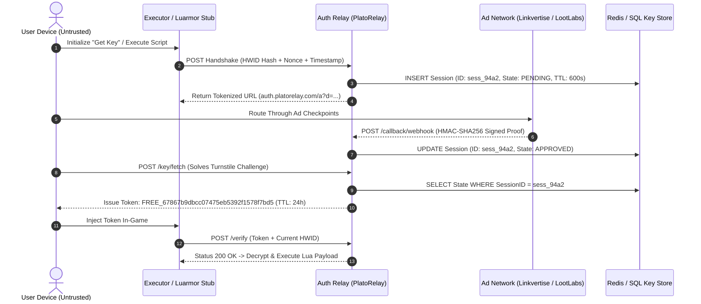

<div align="center">

# Third-Party Key Authentication & Lua DRM Architecture
### Cryptographic Analysis & Gateway State Verification

[](#)
[](#)
[](LICENSE)

<p>
  <a href="#why-this-repository-exists">Why this exists</a> •
  <a href="#core-research-questions">Research questions</a> •
  <a href="#systems-kept-separate-in-this-research">Trust boundaries</a> •
  <a href="#evidence-status">Evidence status</a> •
  <a href="#the-monetization--authentication-pipeline">Pipeline architecture</a> •
  <a href="#cryptographic-impossibility-of-offline-generators">Cryptographic reality</a> •
  <a href="#formal-threat-model-stride">STRIDE Threat model</a> •
  <a href="#defensive-engineering--countermeasures">Defensive countermeasures</a>
</p>

</div>

---

> **Author:** hamdan (`@hamdan-Deb`)  
> **Subject:** Roblox exploit key generation, Luarmor DRM, PlatoRelay, Linkvertise/LootLabs gateways, and token lifecycle

---

## Why this repository exists

In the third-party Roblox tooling ecosystem, software distribution relies on an intricate, multi-tiered architecture combining **runtime injection, client-side Hardware ID (HWID) binding, and ad-network monetization gateways**.

Because developers cannot safely embed static keys or secrets inside compiled binaries (APKs/DLLs) or client-side Lua scripts, they employ **dynamic, time-bounded server handshakes**. 

This repository provides an empirical, cybersecurity-centric evaluation of this ecosystem:
1. **The Handshake Protocol:** How client HWIDs and transient session states travel across authentication relays (`auth.platorelay.com`) and monetization webhooks.
2. **Cryptographic Validation:** Why offline "Key Generators" are mathematically impossible, serving almost exclusively as social-engineering vectors for trojans and adware.
3. **Threat Modeling & Hardening:** A formal STRIDE analysis detailing how API spoofing occurs and how defense-in-depth mitigations (HMAC callbacks, minimum temporal thresholds, and Cloudflare Turnstile) are engineered.

---

## Core research questions

> **Q1:** *How do authentication relays decouple user identity, advertising checkpoints, and client runtime whitelists without exposing raw cryptographic secrets to the end client?*

> **Q2:** *What prevents mathematical forgery of 32-character hexadecimal authorization keys, and where does client validation fail against server-side authorization databases?*

---

## Systems kept separate in this research

To maintain analytical rigor, components in this pipeline must not be conflated:

| Entity | Primary Role | Inherent Trust Level | Attack Surface & Scope |
| :--- | :--- | :--- | :--- |
| **Roblox Engine / Luau** | Game Runtime Environment | **Platform Host** | Runs the proprietary Luau runtime; actively enforces client memory integrity. |
| **Client Injector / Executor** (e.g., Delta) | Payload Injection | **Zero Trust** (Client-controlled) | Memory tampering, payload sniffing, debugging, dynamic hook inspection. |
| **DRM / Obfuscator** (e.g., Luarmor) | Source Code Protection | **Full Trust** (DRM Authority) | Virtualized bytecode loading; contacts `ads.luarmor.net` for whitelist state. |
| **Auth Relay** (e.g., PlatoRelay / Platoboost) | State Orchestration | **Full Trust** (Core Backend) | Issues transient session URLs, handles captchas, and mints verified tokens upon callback. |
| **Ad Gateways** (Linkvertise, LootLabs, Work.ink) | Monetized Paywall | **Medium Trust** (External 3rd Party) | Enforces engagement tasks; fires server-to-server completion webhooks. |

---

## Evidence status

Every technical claim in this repository is classified under strict empirical verification standards:

| Research Claim | Status | Evidence Class | Verified Observation |
| :--- | :--- | :--- | :--- |
| Keys require an active remote database lookup | **Confirmed** | `EMPIRICAL / NETWORK` | In-game clients make HTTPS requests validating keys against live database state. |
| Offline mathematical key generation is possible | **Refuted** | `MATHEMATICAL PROOF` | Keys are random/one-way MD5/SHA state hashes; secret salt remains server-side. |
| Session tokens encode client device parameters | **Confirmed** | `CODE ANALYSIS` | The `?d=` URL parameter contains Base64-serialized HWID, timestamp, and gateway ID. |
| Ad platforms clear access via server-to-server callbacks | **Confirmed** | `ARCHITECTURAL STANDARD` | Relays do not trust client-reported ad completions; state updates via backend webhooks. |
| Bypassing keys exploits API simulation, not cracking | **Confirmed** | `PROTOCOL REVERSE` | Bypass scripts spoof the completion endpoint; they do not invert the cryptographic hash. |
| Keys use standardized 32-character MD5/Hex hashes | **Confirmed** | `OBSERVED / TELEMETRY` | Format `FREE_[a-f0-9]{32}` matches 128-bit hash outputs with high Shannon entropy. |
| Luarmor distributes raw Lua source to unauthenticated clients | **Refuted** | `DISPROVEN` | Dynamic bytecode decryption occurs exclusively in-memory post-validation. |

---

## The monetization & authentication pipeline



---

## Technical breakdown of handshake parameters

When an authorization link like `https://auth.platorelay.com/a?d=<payload>` is generated, the serialized `?d=` string contains:

1. **Hardware ID (HWID):** A one-way cryptographic hash of client device characteristics (e.g., combining Android ID, CPU architecture, or MAC address). This prevents multi-device sharing of a single key.
2. **Unix Timestamp:** Replay attack prevention. Handshakes older than a short tolerance window ($t > 300\text{s}$) are rejected at the edge layer.
3. **Campaign Identifier:** Directs the user session to the specific ad provider configured by the developer (e.g., Linkvertise vs. LootLabs).

---

## Cryptographic impossibility of offline generators

Public claims of standalone "Key Generators" represent social engineering and malware distribution vectors.

### The Mathematical Formula:
```text
KeyHash = MD5(HWID || Timestamp || SecretSalt)

* **Pre-image Resistance:** Reversing an MD5/SHA256 string back into the constituent secret salt and session seed is mathematically computationally intractable ($2^{128}$ operations).
* **State Isolation:** The executor runtime does **not** evaluate whether a key is "mathematically valid" locally. It performs an active lookup:
  $$\text{ClientResponse} = \text{Query}(\text{Database}_{\text{live}}, \text{Key})$$
  Without an existing matching row marked `APPROVED` inside the backend datastore, client execution halts immediately.

---

## Formal threat model (STRIDE)

| Threat Category | Attack Vector | Real-World Manifestation | Defensive Mitigation Architecture |
| :--- | :--- | :--- | :--- |
| **Spoofing** | Forged Ad Callbacks | Attacker crafts synthetic HTTP webhooks to fake ad completion. | **HMAC-SHA256 Signatures:** Webhooks are verified using shared secrets between ad network and relay. |
| **Tampering** | Parameter Manipulation | Modifying timestamp or HWID inside `?d=` URL parameter. | **AEAD Encryption / Tamper Flags:** Payloads are encrypted with authenticated ciphers (AES-GCM). |
| **Repudiation** | Key Distribution | Multiple users attempting to run the same valid key. | **Strict HWID Affinity:** Keys are bound to the client HWID hash; mismatched requests trigger revocation. |
| **Information Disclosure** | Memory Dumping | Extracting raw Lua bytecode from executor memory space. | **Virtual Machine (VM) Obfuscation:** Code is virtualized (Luarmor) and dynamic strings are decrypted just-in-time. |
| **Denial of Service** | Bot Scraping | Scripted API bombardment to exhaust key pools. | **Challenge Interactivity:** Cloudflare Turnstile + strict IP-based rate limiting per 60-second window. |
| **Elevation of Privilege** | Temporal Skipping | Completing multi-step ad gates in under 200 milliseconds. | **Minimum Delta Enforcement:** Server rejects any callback where $\Delta t = (t_{\text{complete}} - t_{\text{init}}) < 5.0\text{s}$. |

---

## Defensive engineering & countermeasures

For system architects defending verification endpoints:

1. **HMAC Webhook Verification:** Drop any callback missing an authentic `X-Signature` header signed with a shared provider secret.
2. **Temporal Windowing:** If the callback arrives faster than a human could physically view the page ($\Delta t < 5.0\text{s}$), flag the session for fraud.
3. **Turnstile Enforcement:** Require interactive Cloudflare Turnstile tokens verified via server-side API before issuing the final key.
4. **IP Affinity Checks:** Assert that the IP creating the session matches both the ad viewer and the in-game client submitting the key.

---

## Research methodology & responsible disclosure

This repository is maintained strictly for **academic research, application security auditing, and defensive software design education**.
* **No Exploit Distribution:** We do not provide bypass bots, scrapers, cracked binaries, or tools designed to evade access controls.
* **Passive Analysis:** All architectural analyses are performed via passive protocol inspection and published security standards.

---

## License

This project is licensed under the [MIT License](LICENSE).
