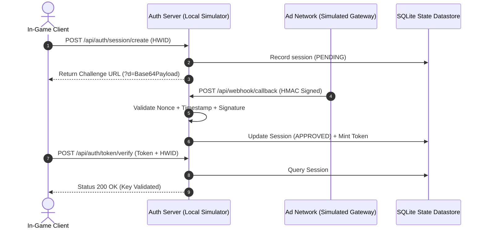

# Authentication Architecture & Verification Simulation

[](#)
[](#)
[](#)

An educational, local cybersecurity laboratory demonstrating how modern authentication relays decouple user identity, advertising checkpoints, and client runtime whitelists.

---

## Important Correction to Historical Community Claims

> **Digest Length vs Algorithm Identity:**  
> A format such as `FREE_67867b9dbcc07475eb5392f1578f7bd5` contains a **32-character hexadecimal string** (128 bits of entropy). While this output length matches an **MD5 digest**, it is equally compatible with:
> 1. A 16-byte random token (`secrets.token_hex(16)`).
> 2. A truncated SHA-256 or BLAKE2 digest.
> 3. An encrypted ciphertext block.
>
> **Evidentiary Standard:** Syntactic structure and string length alone do **not** constitute proof of the underlying hashing algorithm.

---

## Five Essential Security Concepts Demonstrated

1. **Base64 is Not Encryption:**  
   Base64 is an encoding format designed to safely transmit binary data through ASCII-only channels. Anyone with the string can decode it without a secret key.
2. **Hash Fingerprints:**  
   Deterministic hash algorithms (MD5, SHA-256) always generate the exact same digest for identical inputs, serving as mathematical fingerprints.
3. **HMAC Signatures:**  
   A Hash-based Message Authentication Code uses a secret shared key to verify both data **integrity** (has it changed?) and **authenticity** (who sent it?).
4. **Replay Attacks:**  
   Attackers intercept a valid packet and retransmit it. Protection requires strict timestamp tolerance windows combined with single-use Nonces/Event IDs.
5. **Temporary Authorization:**  
   A token may have a genuine cryptographic origin, but once its Time-To-Live (TTL) expires in the database, the server rejects it.

---

## Architecture Flow



---

## Installation & Setup Instructions

```bash
# 1. Clone your repository
git clone https://github.com/hamdan-Deb/Roblox-Executor-Key-System.git
cd Roblox-Executor-Key-System

# 2. Create virtual environment
python3 -m venv venv
source venv/bin/activate  # On Windows: venv\Scripts\activate

# 3. Install dependencies
pip install -r requirements.txt

# 4. Run automated test suite
pytest test_app.py

# 5. Launch web application
python app.py
```
Open your browser and navigate to: **`http://127.0.0.1:5000`**

---

## Example API Requests (`curl`)

### 1. Initialize a Session
```bash
curl -X POST http://127.0.0.1:5000/api/auth/session/create \
  -H "Content-Type: application/json" \
  -d '{"hwid": "DESKTOP_CLIENT_992A"}'
```

### 2. Verify an Authorized Token
```bash
curl -X POST http://127.0.0.1:5000/api/auth/token/verify \
  -H "Content-Type: application/json" \
  -d '{"token": "FREE_67867b9dbcc07475eb5392f1578f7bd5", "hwid_hash": "a1b2c3d4..."}'
```

---

## Defensive Engineering Checklist

- [x] **Rate Limiting:** Prevents endpoint brute-force and request exhaustion.
- [x] **HMAC-SHA256:** Cryptographic integrity on incoming webhooks.
- [x] **Replay Defense:** Single-use Event IDs and 300-second timestamp tolerance.
- [x] **Constant-Time Comparison:** Prevents timing side-channel attacks (`hmac.compare_digest`).
- [x] **HWID Affinity:** Tokens bound strictly to originating device fingerprints.

---

## License
MIT License — see [LICENSE](LICENSE) for details.
